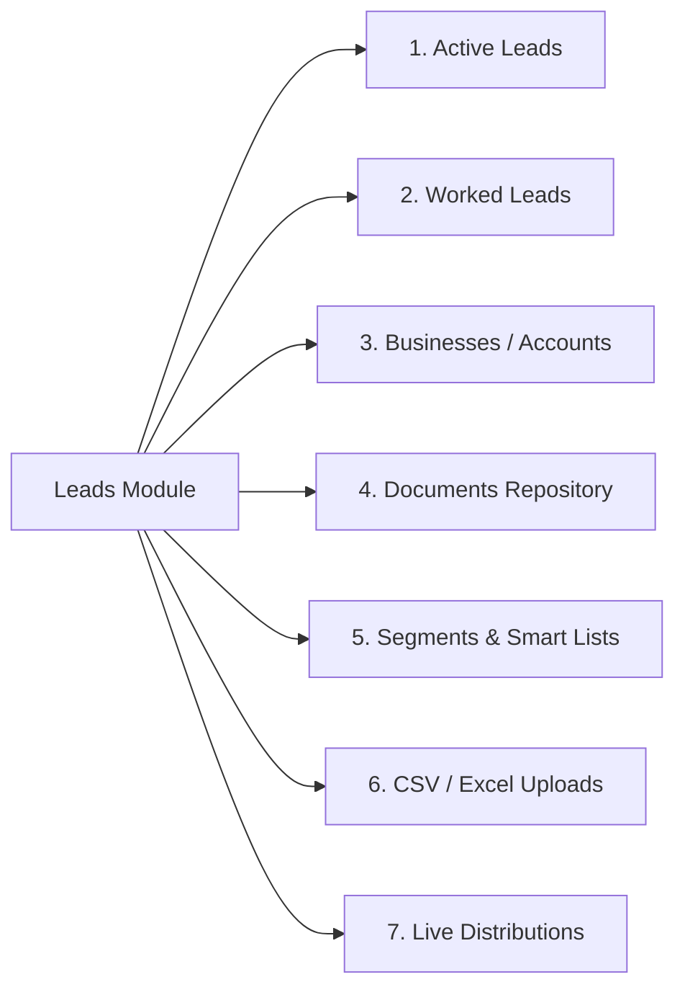
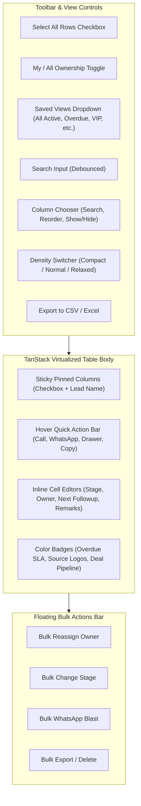

# Salesmax CRM — Global Leads Module & Table Architecture Deep Research Report

> **Target Goal:** Reverse-engineer and benchmark the global product design, telemetry, and leads table component architecture of **Salesmax CRM (`salesmax.ai`)** to build a best-in-class, creative, and high-velocity leads management experience for **SmoothSales.ai CRM**.

---

## 1. Executive Summary & Salesmax CRM Product Philosophy

**Salesmax (`salesmax.ai`)** is an AI-first telecalling and sales execution CRM designed specifically for high-velocity sales organizations (real estate, education/edtech, financial services, B2B manufacturing, and agency services).

Traditional CRMs (like Salesforce or HubSpot) are passive system-of-records where reps manually log data at the end of the day. Salesmax, by contrast, operates as an **active daily operational queue**:
1. **Speed to Lead (< 60 Seconds):** Inbound leads from IndiaMART, JustDial, Meta (Facebook/Instagram) Ads, Google Ads, and Website Forms are ingested via webhooks within milliseconds, auto-assigned via Round-Robin or Geo-Routing, and pushed to the telecaller's screen with click-to-call.
2. **First Touch & Call Telemetry:** The system tracks `speed_to_first_call`, `awaiting_first_touch`, call durations, call directions (inbound/outbound), and call recordings.
3. **Disposition-Driven Lifecycle:** Reps do not manually advance stages through arbitrary dropdowns; every interaction ends in a **Disposition** (e.g., *Connected - Interested, Busy / Callback, Not Reachable, Site Visit Booked*) which automatically updates the pipeline stage and schedules next tasks.
4. **Active vs. Worked Queues:** Rather than showing 10,000 stale leads in one giant list, the CRM strictly bifurcates leads into `Active Leads` (leads requiring action today, unworked leads, upcoming callbacks) and `Worked Leads` (leads with logged attempts and scheduled pipelines).

---

## 2. Salesmax Leads Module: Top-Level Secondary Navigation Architecture

Salesmax structures its Leads Module into **7 dedicated functional views** via a sticky secondary navigation bar:

| Tab | Salesmax Functionality & Business Logic |
| :--- | :--- |
| **1. Active Leads** | Primary work queue. Shows uncontacted leads, scheduled follow-ups, and active prospecting records. Reps spend 85% of their day here. |
| **2. Worked Leads** | Historical archive of touched leads (`attempts > 0` or `last_worked != null`). Allows managers to audit rep productivity, check disposition logs, and re-engage dormant leads. |
| **3. Businesses** | B2B Account rollup. Groups individual leads by company name, GSTIN, website, or enterprise parent entity. |
| **4. Documents** | Centralized KYC, proposals, quotations, identity proofs, and agreement PDFs attached across leads. |
| **5. Segments / Smart Lists** | Dynamic query-based segments (e.g., "VIP Leads > ₹50L", "Unanswered > 3 Calls", "Meta Ads - Delhi NCR", "Overdue > 24 Hrs"). |
| **6. Uploads** | CSV/XLSX bulk ingestion dashboard with column mapping, duplicate detection, and import history logs. |
| **7. Distributions** | Live lead routing engine audit log showing real-time distribution rules (Round-robin, workload balancing, rule-based team routing). |

---

## 3. Master 63-Column Architecture: Exhaustive Breakdown

Salesmax CRM’s leads table provides up to **63 distinct data points**, categorized into **6 core groups + 1 dynamic tenant custom fields group**.

### Group 1: Core Performance & Telecalling SLA (Columns 1–25)

| # | Column ID | Column Header | Data Type | Default Visible | Salesmax Behavior & UI Rendering |
| :---: | :--- | :--- | :--- | :---: | :--- |
| **1** | `lead_name` | **Lead Name** | `lead_name` | **Yes (Locked)** | **Sticky pinned left**. Avatar initials, Full Name (link to detail drawer), source badge pill (`IM`, `META`, `WEB`), unassigned indicator, phone + city preview, and **hover quick-actions bar** (Call, WhatsApp, View, Copy Phone). |
| **2** | `lead_owner` | Lead Owner | `lead_owner` | **Yes** | Rep avatar with initial + name. Click opens inline reassignment popover. Unassigned shows red dashed pill. |
| **3** | `lead_stage` | Lead Stage | `lead_stage` | **Yes** | Tenant-specific pipeline stage badge (e.g., *New, Contacted, Qualified, Proposal, Won, Lost*). Click allows inline stage transition. |
| **4** | `awaiting_first_touch` | 1st Touch | `awaiting_first_touch` | **Yes** | Green checkmark if contacted; pulsating amber warning badge if uncontacted (`Awaiting Touch`). |
| **5** | `attempts` | Attempts | `attempts` | **Yes** | Numerical counter of call/WhatsApp touch attempts. High attempts with 0 connects get visual highlight. |
| **6** | `last_worked` | Last Worked | `relative_time` | **Yes** | Relative timestamp (`2m ago`, `3h ago`, `Yesterday`). Color-coded based on recency. |
| **7** | `started_work_on` | Started Work On | `relative_time` | No | Timestamp of the first time any rep opened or logged work on the lead. |
| **8** | `speed_to_first_call`| Speed to 1st Call | `speed_to_first_call` | No | SLA metric (`45s`, `3m`, `2h`). Shows whether the lead met the company's < 5 min SLA. |
| **9** | `next_followup` | Next Followup | `next_followup` | **Yes** | Date & Time picker. **Red alert badge** if overdue; **Amber badge** if due today; **Neutral** if future. |
| **10**| `became_opportunity` | Became Opp | `relative_time` | No | Timestamp when the lead crossed the threshold from cold lead to qualified opportunity. |
| **11**| `tags` | Tags | `tags` | **Yes** | Colored multi-tag pills (e.g., `VIP`, `Budget Buyer`, `NRI`, `High Intent`). |
| **12**| `product_or_service` | Product / Service | `text` | No | Specific SKU, project name, or service package the lead inquired about. |
| **13**| `recent_actions` | Recent Actions | `text` | No | Brief summary of the latest event (e.g., *Call logged 14m ago*, *WhatsApp template sent*). |
| **14**| `unanswered_calls` | Unanswered Calls | `number` | No | Total outgoing calls made that went unanswered by the lead. |
| **15**| `answered_after_missed`| Answered After Missed| `number` | No | Count of times the lead answered after previous missed attempts. |
| **16**| `missed_calls_from_them`| Inbound Missed | `number` | No | **Urgent indicator:** Number of times the lead called the company and no rep answered. |
| **17**| `last_user_remark` | Last Remark | `tooltip_text` | **Yes** | Truncated latest note with full note in hover tooltip. Pencil icon for inline fast-add remark. |
| **18**| `next_open_task` | Next Open Task | `text` | No | Scheduled task title (e.g., "Send revised pricing PDF by 3 PM"). |
| **19**| `open_ticket` | Open Ticket | `text` | No | Support/Issue ticket ID linked to the prospect. |
| **20**| `last_closed_task` | Last Closed Task | `text` | No | Previous completed task reference. |
| **21**| `deal_stage` | Deal Stage | `deal_stage` | No | Visual 6-segment mini progress bar showing pipeline progression. |
| **22**| `deal_updated_on` | Deal Updated On | `relative_time` | No | Timestamp of last deal modification. |
| **23**| `times_re_engaged` | Times Re-engaged | `number` | No | Number of times a dormant/lost lead was reactivated. |
| **24**| `lead_disposition` | Lead Disposition | `lead_disposition` | No | Standardized outcome of last call (*Call Complete - Positive, Callback Requested, Junk Lead*). |
| **25**| `last_disposition_on`| Last Disposition On| `relative_time` | No | Timestamp when the disposition was recorded. |

---

### Group 2: Contact, Business & Location (Columns 26–36)

| # | Column ID | Column Header | Data Type | Default Visible | Salesmax Behavior & UI Rendering |
| :---: | :--- | :--- | :--- | :---: | :--- |
| **26**| `business` | Business / Company | `text` | No | Company or organization name with building icon. |
| **27**| `mobile_number` | Mobile Number | `phone` | No | Formatted `+91 XXXXX XXXXX` with one-click copy and click-to-call. Masking toggle for privacy. |
| **28**| `email` | Email | `text` | No | Prospect email address with mailto trigger. |
| **29**| `address` | Address | `tooltip_text` | No | Street address with hover tooltip. |
| **30**| `state` | State | `text` | No | State or province (e.g., Maharashtra, Karnataka). |
| **31**| `city` | City | `text` | No | City (e.g., Mumbai, Bengaluru, Delhi). |
| **32**| `area` | Area / Locality | `text` | No | Sub-locality or neighborhood (e.g., Whitefield, Andheri East). |
| **33**| `country` | Country | `text` | No | Country code or name (India, UAE, USA). |
| **34**| `zipcode` | Zipcode | `text` | No | Postal code / PIN code. |
| **35**| `primary_team` | Primary Team | `text` | No | Sales unit or department (e.g., *Inbound Inside Sales, Enterprise Desk*). |
| **36**| `designation` | Designation | `text` | No | Job title / Role (e.g., *Founder, Procurement Head, Senior Architect*). |

---

### Group 3: Classification & Omnichannel Source Attribution (Columns 37–44)

| # | Column ID | Column Header | Data Type | Default Visible | Salesmax Behavior & UI Rendering |
| :---: | :--- | :--- | :--- | :---: | :--- |
| **37**| `lead_type` | Lead Type | `text` | No | Category (e.g., B2B, B2C, Channel Partner, Vendor). |
| **38**| `lead_priority` | Lead Priority | `priority_stars` | **Yes** | 1 to 5 clickable golden star rating for visual triage. |
| **39**| `lead_source` | Lead Source | `lead_source` | **Yes** | Visual source pill with official brand icon (IndiaMART, JustDial, Meta Ads, Google Ads, Website). |
| **40**| `source_level_2` | Source Level 2 | `text` | No | Campaign name (e.g., `Q4_RealEstate_Bangalore_Festive`). |
| **41**| `source_level_3` | Source Level 3 | `text` | No | Adset / Keyword group (e.g., `Luxury_3BHK_KeywordGroup`). |
| **42**| `source_level_4` | Source Level 4 | `text` | No | Creative ID / Ad copy reference. |
| **43**| `last_engagement_by_us`| Engaged By Us | `relative_time` | No | Timestamp of the last outbound interaction initiated by the team. |
| **44**| `last_engagement_by_lead`| Engaged By Lead | `relative_time` | No | Timestamp of the last inbound interaction from the customer. |

---

### Group 4: Payments & Commercials (Columns 45–47)

| # | Column ID | Column Header | Data Type | Default Visible | Salesmax Behavior & UI Rendering |
| :---: | :--- | :--- | :--- | :---: | :--- |
| **45**| `last_payment_status` | Payment Status | `payment_status` | No | Status badge: `Paid`, `Pending`, `Partial`, `Refunded`. |
| **46**| `last_payment_amount` | Last Payment | `currency_inr` | No | Formatted in Indian Rupee format (`₹1,50,000`). |
| **47**| `total_payment` | Total Payment | `currency_inr` | No | Lifetime value (LTV) / Total collection received. |

---

### Group 5: Telephony & Field Visits (Columns 48–55)

| # | Column ID | Column Header | Data Type | Default Visible | Salesmax Behavior & UI Rendering |
| :---: | :--- | :--- | :--- | :---: | :--- |
| **48**| `last_call_direction` | Last Call Dir | `call_direction` | No | Incoming (Green arrow down) vs Outgoing (Blue arrow up). |
| **49**| `last_call_outcome` | Last Call Outcome | `text` | No | Detailed telephony result (*Answered, Busy, Switched Off, Network Error*). |
| **50**| `last_call_nature` | Last Call Nature | `text` | No | Objective of the call (*Pitch, Discovery, Follow-up, Payment Reminder*). |
| **51**| `last_called_by` | Last Called By | `text` | No | Telecaller name who made the last call. |
| **52**| `last_visit` | Last Visit | `relative_time` | No | Timestamp of in-person field visit or showroom walkthrough. |
| **53**| `last_visit_outcome` | Visit Outcome | `text` | No | Result of in-person visit (*Site visit completed, Rescheduled, No-show*). |
| **54**| `last_visit_nature` | Visit Nature | `text` | No | Category (*Property demo, Office meeting, Technical audit*). |
| **55**| `last_visit_by` | Last Visit By | `text` | No | Field sales executive name who conducted the visit. |

---

### Group 6: Meta & System Flags (Columns 56–57)

| # | Column ID | Column Header | Data Type | Default Visible | Salesmax Behavior & UI Rendering |
| :---: | :--- | :--- | :--- | :---: | :--- |
| **56**| `last_updated` | Last Updated | `relative_time` | No | Timestamp of any attribute modification on the lead. |
| **57**| `is_duplicate` | Is Duplicate | `boolean_badge` | No | Warning badge if phone or email matches an existing customer in database. |

---

### Group 7: Multi-Tenant Custom Fields (Columns 58–63+)
Salesmax allows each tenant (company) to declare custom business fields that automatically append to the table:
* Real Estate: `budget_range`, `property_type` (Villa/Apartment), `project_stage`, `site_location_preference`.
* EdTech: `student_grade`, `target_exam` (NEET/JEE/CAT), `parent_name`.
* B2B / SaaS: `annual_revenue`, `current_tool`, `seat_count`.

---

## 4. Salesmax Leads Table Component: Deep UX & Interaction Engine

### 1. Sticky Pinned Columns
- Checkbox and `lead_name` stay pinned to the left when horizontally scrolling through 63 columns.
- Uses subtle shadow separators (`after:shadow-[inset_10px_0_8px_-8px_rgba(0,0,0,0.15)]`) to cleanly demarcate sticky columns from scrollable data.

### 2. Hover Quick Action Bar
- Hovering any row reveals floating action buttons:
  - 📞 **Click-to-Call (`tel:` or Cloud Dialer)**: Initiates immediate phone call.
  - 💬 **1-Click WhatsApp (`wa.me` with prefilled template)**: Opens WhatsApp chat with customer.
  - 📋 **Copy Phone Number**: Copies clean number to clipboard with toast notification.
  - 👁️ **Quick View Drawer**: Slides out full customer timeline and activity logs without leaving the page.

### 3. Smart Saved Views (Instant Filter Presets)
- `All Active`: All non-closed leads requiring attention.
- `My Leads`: Filtered strictly by logged-in telecaller ID.
- `Unassigned Pool`: Fresh inbound leads waiting for distribution.
- `Follow-up Overdue`: Leads where `next_followup < NOW()`.
- `High Intent / VIP`: Star priority >= 4 or high budget tag.

---

## 5. UI/UX Gap Analysis & Improvement Roadmap for SmoothSales CRM

Comparing our current `apps/crm/src/components/leads/lead-table.jsx` with full Salesmax parity:

| Feature / UI Area | Current SmoothSales State | Target Salesmax Parity State | Action Plan |
| :--- | :--- | :--- | :--- |
| **Table Virtualization** | Standard React Table pagination (15 rows/page) | Virtualized infinite scroll + sticky header (handles 500+ rows smoothly) | Add `@tanstack/react-virtual` for buttery smooth 60fps scrolling |
| **Visual Polish & Styling** | Good shadcn base, plain borders | Glassmorphism, ambient glow on overdue rows, modern badges | Apply our `creative-frontend-craft` tokens (`border-white/10`, subtle glows) |
| **Overdue Followup SLA Alerts** | Text date display | Pulsating amber/red alert pill with countdown badge (`Overdue by 2h`) | Enhance `next_followup` cell renderer with visual SLA countdown |
| **Deal Stage Pipeline Pill** | Basic text | 6-segment interactive mini progress bar | Build a segmented micro-progress component for `deal_stage` |
| **Inline Fast Remarks** | View in tooltip | Inline quick-edit dialog to add remark without leaving row | Add pencil icon trigger that opens an inline popover to save remark |
| **Column Chooser** | Basic popover with checkboxes | Grouped tree view (Core, Contact, etc.) with search & drag-and-drop | Upgrade `columns-popover.jsx` with group accordion headers |

---

## 6. Phased Implementation Roadmap

1. **Phase 1: Cell Renderer & Badge Polish (Immediate)**
   - Upgrade `next_followup` with real-time overdue SLA color coding (red badge if overdue, amber if due in 3 hours, green if scheduled).
   - Add brand icons for IndiaMART, JustDial, Meta Ads, and Google Ads in `lead_source` cells.
   - Add interactive 5-star rating widget in `lead_priority`.

2. **Phase 2: Quick-Action & Telephony Upgrades**
   - Enhance the hover quick-actions bar with WhatsApp pre-filled template triggers.
   - Implement fast inline remark adder popover directly in the table cell.

3. **Phase 3: Column Chooser & Saved Views Enhancement**
   - Categorize column chooser by the 7 groups (Core, Contact, Classification, Payments, Calls, Meta, Custom).
   - Add 1-click preset switches in the toolbar.

4. **Phase 4: Performance & Virtualization**
   - Ensure table remains responsive even with 63 columns and 100+ active rows enabled.

